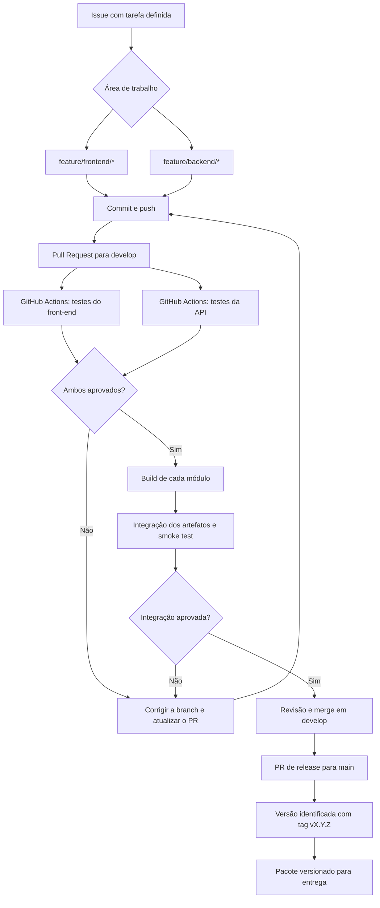

# Atividade de GCS — Controle de versão e geração de builds

## 1. Desafio

Uma ONG precisa de uma aplicação web para divulgar animais disponíveis para adoção e controlar adoções realizadas. Voluntários trabalham remotamente em dois grupos: front-end e back-end. É necessário controlar os artefatos de cada grupo e gerar builds confiáveis da aplicação.

## 2. Estratégia proposta

A dupla adotará **Git + GitHub**, utilizando **um repositório monorepo** com dois módulos independentes: `frontend/` (interface) e `backend/` (API e persistência). Essa divisão permite que os desenvolvedores trabalhem de forma assíncrona e mantenham um histórico integrado da solução. Os arquivos de documentação ficam em `docs/`, e a automação de integração contínua fica em `.github/workflows/ci.yml`.

Serão utilizadas as seguintes branches:

| Branch | Objetivo |
| --- | --- |
| `main` | Versões estáveis e revisadas, candidatas a uma entrega. |
| `develop` | Integração das funcionalidades aprovadas. |
| `feature/frontend/nome` | Funcionalidades da interface. |
| `feature/backend/nome` | Funcionalidades da API. |
| `fix/nome` | Correções pontuais. |

Cada alteração deve nascer de uma **Issue** documentando a demanda e ser feita em uma branch específica criada a partir de `develop`. O desenvolvedor registra commits pequenos e descritivos, envia a branch ao GitHub e abre um **Pull Request (PR)** para `develop`. A dupla revisa o PR, verifica os testes e só faz o merge quando os controles são aprovados. Quando `develop` está validada, abre-se outro PR para `main`.

Padrão sugerido de commits: `feat(frontend): criar filtro por espécie`, `feat(backend): registrar adoção`, `fix(backend): impedir dupla adoção`, `docs: atualizar estratégia`.

## 3. Workflow do versionamento à build



### O que o GitHub Actions faz

1. **Disparo automático:** em `push`, PR ou execução manual.
2. **Front-end:** executa testes de filtragem e gera `frontend/dist/`.
3. **Back-end:** testa cadastro, adoção, validações e gera `backend/dist/`.
4. **Integração:** baixa os dois artefatos da **mesma revisão (SHA)**, inicia a aplicação e confirma que página e API respondem.
5. **Publicação de artefatos:** gera `frontend-<SHA>`, `backend-<SHA>` e `adota-pet-completo-<SHA>` para download no GitHub Actions.

O **SHA do commit** permite rastrear exatamente qual código originou cada build. As **tags SemVer** (por exemplo, `v1.0.0`) marcam versões entregáveis no histórico Git. Os artefatos temporários do Actions são retidos por 14 dias; a tag permanece no repositório.

## 4. Controle de configuração

Artefatos controlados:
- arquivos de interface `.html`, `.css`, `.js`;
- arquivos de API `.mjs` e contratos das rotas `/api/*`;
- testes unitários e de integração;
- workflow YAML, documentação, templates de PR e configuração Git;
- versões de build identificadas pelo commit.

Não entram no Git: dados locais de adoções, credenciais, arquivos `.env`, builds `dist/` nem dependências instaladas. Essas exclusões estão em `.gitignore`. O projeto não possui dependências npm externas, facilitando a reprodução dos builds em computadores diferentes.

## 5. Responsabilidades dos integrantes

- **Integrante 1 / equipe de front-end:** HTML, CSS, JavaScript, interface responsiva, filtros e testes do módulo `frontend/`.
- **Integrante 2 / equipe de back-end:** API REST, persistência JSON, regras de cadastro/adoção e testes de `backend/`.
- **Ambos:** revisão dos PRs, definição do contrato da API, integração e aprovação da release.

Mesmo que os desenvolvedores tenham horários diferentes, cada tarefa, commit, issue, revisão e build fica registrado no GitHub, oferecendo rastreabilidade e reduzindo conflitos.

## 6. Exemplo de entrega

Para a primeira versão estável, após integrar as funcionalidades em `main`:

```bash
git switch main
git pull origin main
git tag -a v1.0.0 -m "Primeira versão estável da ONG"
git push origin v1.0.0
```

A tag dispara o workflow de testes e builds. A dupla pode baixar o artefato `adota-pet-completo-<SHA>` da execução correspondente e apresentá-lo como evidência de entrega.

## 7. Limitação assumida

A persistência em JSON e o registro simples de adoção são adequados **somente a uma demonstração acadêmica local**. Uma ONG real precisa de autenticação, autorização de operadores, proteção dos dados pessoais conforme a LGPD, banco de dados e fluxo de aprovação da adoção.

**Resposta ao desafio:** a estratégia é usar Git/GitHub com divisão em módulos, branches por funcionalidade, PR com revisão, CI automática para testes independentes, build integrado validado e versionamento por SHA/tag, garantindo rastreabilidade dos artefatos produzidos por voluntários remotos.
